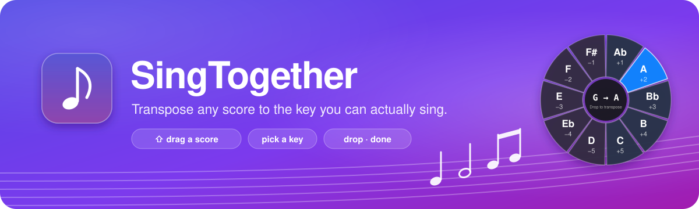
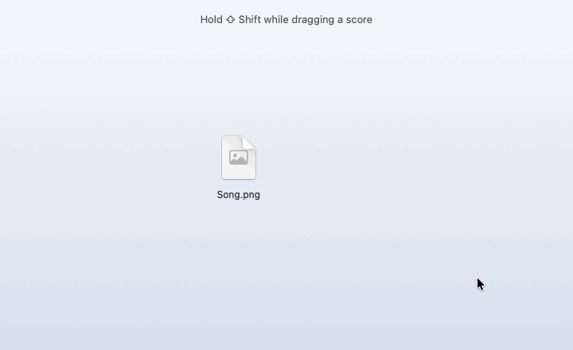

<p align="center">
  <a href="https://github.com/Jongwan93/SingTogether/releases/latest"></a>
</p>

<p align="center">
  <a href="https://github.com/Jongwan93/SingTogether/releases/latest"></a>
  
  <a href="LICENSE"></a>
</p>

A macOS menu bar app that transposes sheet music to the key you can actually sing.
Drag a score, pick a key, and a transposed copy appears next to the original. The original is never touched.
Text chord sheets, MusicXML, and pictures of scores (web images, scans, PDFs) all work.



```
Song.txt       →  drop on +2  →  Song (+2, A).txt
Song.musicxml  →  drop on −3  →  Song (-3, E).musicxml
Song.png       →  drop on −2  →  Song (-2, F).png   (redrawn in the new key, + a review window)
Song.pdf       →  drop on −2  →  Song (-2, F).pdf
Chart.jpg      →  drop on +2  →  Chart (+2, A).jpg   (same image, new chords)
```

## Install

1. Download `SingTogether-<version>.dmg` from the [latest release](https://github.com/Jongwan93/SingTogether/releases/latest).
2. Open it and drag SingTogether to Applications.
3. The first time, macOS blocks the app because it is not notarized. Allow it once:
   - macOS 15 or later: double-click the app, click **Done**, then open **System Settings → Privacy & Security**,
     scroll down to *"SingTogether" was blocked* and click **Open Anyway**.
   - macOS 14 or earlier: right-click the app and choose **Open**, then **Open** again.
4. A ♪ icon appears in the menu bar. Everything needed to read image scores is inside the app.
   If the app was opened from Downloads or the disk image, it offers to move itself to Applications.

macOS may ask once for permission to access the Desktop or Documents folder.

## How to use

1. Click the ♪ icon to check it is running.
2. In Finder, start dragging a score file and hold **Shift** (or ⌘⇧).
3. A ring with −5 … +5 appears around the cursor. For text and MusicXML files it also shows the key each slot gives you,
   and the center shows the change (`G → A`) while you hover.
4. Drop the file on a slot. The transposed copy is created in the same folder. Drop on the center to cancel.

For images and PDFs the app first has to *read* the score, which takes 10 seconds to a minute. The ring shows progress, and when it is done a review window opens (see below).

## Supported files

| File | What gets transposed | Accuracy |
|---|---|---|
| `.txt` `.cho` `.chordpro` `.crd` (chord sheets) | chord lines above lyrics, inline `[G]` chords, runs like `Bb9-Dm7-Eb-F`; spelling follows the new key (E major's `B/D#` becomes `C#/E#` in F♯) | exact |
| `.musicxml` `.xml` `.mxl` | every note, key signature, accidentals, chord symbols | exact (verified against music21 on 212 files) |
| `.png` `.jpg` `.webp` `.pdf` with staff notation | recognized, transposed, redrawn as a new image of the same kind (PNG or JPEG; PDF in, PDF out) | depends on image quality, see below |
| `.png` `.jpg` `.webp` `.pdf` chord charts (chords + lyrics only) | chords rewritten in place on the original image | 97–100% with an AI reader, 80–96% without |

Nothing to try it on? [`samples/`](samples/) has three public-domain hymns as clean score images: Amazing Grace, Silent Night and Holy, Holy, Holy. Drop one on the ring.

## AI reader for chords and lyrics (optional)

Notes are always read on your Mac. Chords and lyrics are read much more accurately when an AI command-line tool is installed and signed in:

- **Claude:** [Claude Code](https://claude.com/claude-code) (`claude`), signed in with a Claude account.
- **Gemini:** Google [Antigravity](https://antigravity.google) (`agy`), or the Gemini CLI (`gemini`) on a paid plan.

When the app starts it asks *Which AI should read your scores?* with a button for each, then checks that the one you picked is signed in.
If it is not, the app tells you how to sign in and uses Apple Vision alone until you do. Change the choice later with **Reading with … — Change…** in the ♪ menu or in Settings.
If the AI answers with something that does not match the image (a different song, made-up chords), the answer is discarded and Apple Vision is used for that score.

**Privacy:** with an AI reader, the score image is sent to that service (Anthropic or Google) under your own account.
With **Apple Vision only**, nothing leaves your Mac except the once-a-day version check described under [Updates](#updates-and-problems), which you can turn off.

## Settings

♪ menu → **Settings…** (⌘,):

- **Open SingTogether at login.**
- **Ask which AI to use when the app starts.** Turn it off once you have chosen.
- **Open the review window after reading an image score**, and **play a sound** when a file is created.
- **Check for updates when the app starts.**
- **Transposing:** when the new key can be written both ways (F♯ or G♭), follow the original (a ♯ score gets F♯, a ♭ score gets G♭), always sharps, or always flats. And whether transposed image scores come back as images (PNG or JPEG, the default) or as PDF.
- **Reading image scores:** Claude, Gemini, or Apple Vision only (see [AI reader](#ai-reader-for-chords-and-lyrics-optional)), with the sign-in status and a **Check sign-in** button.
- **Recognition cache:** how much space the remembered results take, and a button to clear it.

## Updates and problems

- **Updates:** once a day at start, the app asks GitHub for the latest release. If there is a newer one, an **Update to SingTogether …** item appears at the top of the ♪ menu and opens the download page; the app tells you once per new version. **Check for Updates…** in the ♪ menu asks right away. Nothing but the version request is sent.
- **Report a Problem…** in the ♪ menu opens a new GitHub issue with the app and macOS versions and the last recognizer log filled in. You see the exact text first, your scores are never included, and the same text is copied to the clipboard in case the page cuts it short. The log is also at `~/Library/Logs/SingTogether/recognizer.log`.

## Image scores: recognize, transpose, review

Recognition is never perfect, so every image score opens a review window:

- **Left:** the original with suspicious spots marked. Red boxes are notes (thick for the 12 most doubtful, thin for the rest), orange are chords, purple are lyric syllables. Each note is labeled with its measure number and what was read.
- **Right:** the transposed score. Notes that need checking are drawn in red.
- **Next doubtful** (or the **N** key) jumps to the next unfixed note, most doubtful first, scrolls to it and opens its editor, so you can walk through the flags in order instead of hunting for them.
- **Click a note** on the left to fix it on the spot: a step up or down, ♯/♭, length, turn into a rest, delete, or type the chord that sits over it. The transposed file is rebuilt right away. Fixed items get a green outline. The editor also says why the note was flagged.
- **Hear it.** Clicking a note plays it as it was read, and so does every step up or down. **▶ Note** and **▶ Measure** in the editor replay the note or its measure; **▶ Play** above the image (or the space bar) plays the whole melody from the start, highlighting each note as it sounds. Tempo is in the ♩ menu. Nothing plays until you ask.
- **Click a chord or a lyric syllable** (the orange and purple boxes, but any chord or syllable works) to retype it or remove it.
- **Undo** (⌘Z or the button) takes back the last click-fix.
- For bigger changes use **Edit Text…**, which opens the score as plain text (format below), then **Rebuild from Text**.
- **Save as Truth…** stores the corrected score as ground truth for the recognizer's evaluation (see Development). Use it when every note, chord and syllable is right.
- A score is recognized only once. Results are cached by file content in `~/Library/Caches/SingTogether/`, so dropping the same image again is instant.

To try it without dragging, quit SingTogether and run `open -a SingTogether --args --sheet score.png -2`.

### Chord charts

Sheets that only have chords above lyrics (no staff) are not redrawn. The app keeps the original image and rewrites just the chord symbols:
it erases each chord, then writes the new one in the same place, colour and size, in the closest matching system font.
Title, lyrics, layout and watermarks stay exactly as they were. Hyphenated runs like `Bb9-Dm7-Eb-F` are rewritten as a whole.
If a chord could not be found in the image, the review window says so and marks the spot.
The font is guessed from the original letters, which works for sans-serif charts but often misses serif ones (Times, Georgia):
pick the right one from the **Font** menu in the review window and the image is redrawn. The same window's **Edit Text…** and
**Rebuild from Text** work for chord charts too, rewriting the chords on the image.

### What to expect

Measured on four Korean worship lead sheets with hand-checked ground truth:

| Input | Pitch | Pitch + rhythm | Chords | Lyrics |
|---|---|---|---|---|
| Image saved from a web search (500–800 px) | 32–80% | 28–74% | 91–100% | 41–87% |
| Clean PDF or high-resolution scan | 92–100% | 86–100% | – | – |

Most church teams use web images, so expect to fix some notes; very small images (about 500 px wide) can lose whole measures.
Measure boundaries are taken from the barlines in the image, so chords stay on the right measure even when the note engine
splits or merges one, and the AI reads the page one staff line at a time, which is what makes chords and lyrics this reliable.
The review marks catch 71–95% of the real errors, and **Next doubtful** takes you through them most-likely-wrong first. If you can get the original PDF from the publisher, use that: the engine reads clean input almost perfectly.

### The text format

Recognized scores are also written as a `.txt` you can read and edit. Chord charts use the same idea with chords above lyrics.

```
title: Amazing Grace
key: G major
time: 3/4
1: D4/4 | A
2: [G] G4/2 B4/8 G4/8 | maz ing _
3: B4/2 A4/4 | grace how
4: [C] G4/2 E4/4 | sweet the
5: [G] D4/2 D4/4 | sound that
```

Notes are `<name><#|b><octave>/<length>[.][~]` (C4 is middle C, `~` ties to the next note), rests are `r/8`, chords are `[G]`,
repeats are `{: :}`, endings are `{1 {2`. After `|` come the lyrics, one syllable per note (rests skipped), `_` meaning no new syllable.
Edit the file, then drop it on the ring or run `singtogether-ocr fixed.txt --transpose -2 --render`.

## Command line

Both tools ship inside the app:

```bash
APP=/Applications/SingTogether.app/Contents
$APP/MacOS/singtogether-transpose Song.musicxml -2                     # same rules as the app, any supported file
$APP/MacOS/singtogether-transpose Song.txt 4 --flats                   # Gb rather than F# when both fit (--sharps; or SINGTOGETHER_ENHARMONIC=flats)
$APP/MacOS/singtogether-transpose Song.png -2 --pdf                    # image score → PDF instead of an image
$APP/Resources/ocr/bin/singtogether-ocr score.jpg                      # → score.musicxml, score.txt, score.review.json, score-p1.review.png
$APP/Resources/ocr/bin/singtogether-ocr score.jpg --transpose -2 --render     # + transposed copy and PDFs
$APP/Resources/ocr/bin/singtogether-ocr chart.jpg --llm claude --transpose 2  # chord chart → image with new chords + .txt
```

In a source build they are `.build/release/singtogether-transpose` and `tools/ocr/.venv/bin/singtogether-ocr`.

Useful `singtogether-ocr` options: `--engine homr|hybrid|auto` (hybrid reads notes locally and text with the AI CLI; auto picks hybrid when one is available),
`--llm claude|gemini|none|auto` to choose the AI for chords and lyrics, `--check-llm claude|gemini` to report whether it is installed and signed in,
`--source IMAGE` with a chord-chart `.txt` to rewrite the chords on that image, `--chart-font NAME` to force the font,
`--debug DIR` to save an overlay image per pipeline stage, `--no-cache`.

## Limits

- Single-line melody with chords and lyrics is the target. Whole notes, tuplets, multiple voices and two-staff piano scores are not handled.
- Accuracy follows image quality. Upscaling the image does not help (tested); a better source file does.
- The disk image is built for Apple Silicon only. It is signed ad hoc, not notarized, so the first launch has to be allowed once (see Install).

## Development

Build from source:

```bash
xcode-select --install          # once, if you don't have the Command Line Tools
./build.sh                      # builds build/SingTogether.app and build/singtogether-transpose
cd tools/ocr && uv sync         # once: Python 3.13 environment for the recognizer (homr, Verovio); needs uv
open build/SingTogether.app
```

A source build looks for `tools/ocr/.venv/bin/singtogether-ocr` inside this repository. If it lives elsewhere, point the `SINGTOGETHER_OCR` environment variable at it.

**CI and releases.** Every push runs [`ci.yml`](.github/workflows/ci.yml) on a macOS runner: build, self-test, the rendered regression on the public-domain samples, and one end-to-end transposition of a sample image.
A release is a pushed tag: bump the version in `Info.plist`, commit, then `git tag -a v1.4 -m "SingTogether 1.4" -m "<release notes>"` and push the tag. [`release.yml`](.github/workflows/release.yml) checks that the tag matches the plist, runs `dist.sh`, verifies the disk image and publishes it with the tag message as the notes. A tag like `v1.4-dry` runs the same build and checks without publishing.

```
Sources/App/        menu bar app: ring, drag detection, review window, note editor
Sources/Transpose/  transposition logic shared by app and CLI, plus the bridge to the recognizer
Sources/TransposeCLI/  singtogether-transpose
tools/ocr/          recognizer (Python): ingest → layout → OMR → chords/lyrics OCR → assemble → review → MusicXML → render
tools/ocr/truth/    hand-checked ground truth for the evaluation
```

```bash
./dist.sh                                               # self-contained dist/SingTogether.app and dist/SingTogether-<version>.dmg (needs uv)
.build/release/singtogether-transpose --selftest        # text transposition and note editing checks
cd tools/ocr
.venv/bin/singtogether-eval --engines homr hybrid       # recognition accuracy against truth/ → out/report.md
.venv/bin/singtogether-eval --rendered                  # clean-render regression test for the assembly stage (all truth files, three widths)
.venv/bin/singtogether-eval --rendered --samples "Amazing Grace" "Silent Night" "Holy, Holy, Holy" --widths 1240 --fail-below 90   # what CI runs
.venv/bin/singtogether-eval --chordsheets --llm none    # chord charts
.venv/bin/singtogether-eval --missing                   # sample scores that have no ground truth yet
.venv/bin/singtogether-eval --tune                      # refit the review-flag weights (review.WEIGHTS) on the hybrid results
.venv/bin/singtogether-eval --engines claude+page claude homr@staff    # experiments: AI on the whole page vs per-system crops (default), preprocessing variants
```

Sample scores go in `music_scores/korean` and `music_scores/english` (not in the repository, they are copyrighted);
the public-domain hymns in `samples/` are rendered from their truth files and are evaluated the same way.
The evaluation pairs each image with `tools/ocr/truth/<same name>.txt`. The quickest way to add a truth file is the app:
drop the score, fix everything in the review window, then **Save as Truth…** — when the app runs from this repository it
offers `tools/ocr/truth/` directly and copies the image into `music_scores/` if it is not there yet. Chord charts go to
`truth/chordsheets/`.

`dist.sh` copies a relocatable Python 3.13 (uv's managed build) into the app, installs `tools/ocr` into it, bundles homr's model files,
and signs everything. With `DEVELOPER_ID="Developer ID Application: …"` and `NOTARY_PROFILE=<notarytool keychain profile>` set,
it signs with that identity and notarizes the disk image. SVG to PDF rendering uses WebKit through `singtogether-transpose --svg-to-pdf`,
so no Homebrew packages are needed at run time.

To publish a release: raise `CFBundleShortVersionString` in `Info.plist`, run `./dist.sh`, then
`gh release create v<version> dist/SingTogether-<version>.dmg`.

## License

SingTogether is free software under the [GNU Affero General Public License v3.0](LICENSE): use it, share it and change it
as you like; if you distribute a modified version (or run one as a service), publish your changes under the same license.
The bundled recognizer homr and PyMuPDF are AGPL-3.0 as well; see [THIRD_PARTY.md](THIRD_PARTY.md) for everything the app ships with.
