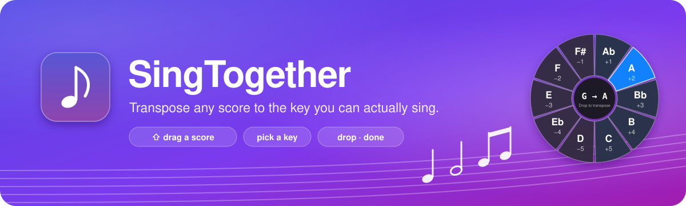
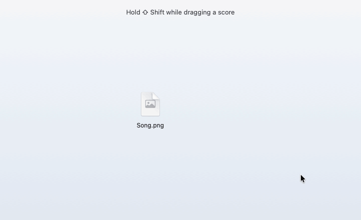

  

  
  
  

A macOS menu bar app that transposes sheet music to the key you can actually sing.
Drag a score, pick a key, and a transposed copy appears next to the original. The original is never touched.
Text chord sheets, MusicXML, and pictures of scores (web images, scans, PDFs) all work.

## Install

**You need a Mac with Apple Silicon (M1 or later) and macOS 14 (Sonoma) or later.**
To see what you have, open the Apple menu and choose **About This Mac**. On macOS 12 or 13 the app does not open: macOS says it
needs a newer version. Every Apple Silicon Mac can be updated for free in **System Settings → General → Software Update**.
Intel Macs are not supported.

1. Download `SingTogether-<version>.dmg` from the [latest release](https://github.com/Jongwan93/SingTogether/releases/latest).
2. Open it and drag SingTogether to Applications.
3. The first time, macOS blocks the app because it is not notarized. Allow it once:
   - macOS 15 or later: double-click the app, click **Done**, then open **System Settings → Privacy & Security**,
     scroll down to *"SingTogether" was blocked* and click **Open Anyway**.
   - macOS 14: right-click the app and choose **Open**, then **Open** again.
4. A ♪ icon appears in the menu bar. For image scores, also set up an [AI reader](#ai-reader-for-chords-and-lyrics).
   If the app was opened from Downloads or the disk image, it offers to move itself to Applications.

macOS may ask once for permission to access the Desktop or Documents folder.

## How to use

1. Click the ♪ icon to check it is running.
2. In Finder, start dragging a score file and hold **Shift** (or ⌘⇧).
3. A ring with −5 … +5 appears around the cursor. For text and MusicXML files it also shows the key each slot gives you,
   and the center shows the change (`G → A`) while you hover.
4. Drop the file on a slot. The transposed copy is created in the same folder. Drop on the center to cancel.

For images and PDFs the app first has to find the notes and read the chords, which takes 10 seconds to a minute. The ring shows progress, and when it is done a review window opens.

## Supported files

| File | What gets transposed | Accuracy |
|---|---|---|
| `.txt` `.cho` `.chordpro` `.crd` (chord sheets) | chord lines above lyrics, inline `[G]` chords, runs like `Bb9-Dm7-Eb-F`; spelling follows the new key (E major's `B/D#` becomes `C#/E#` in F♯) | exact |
| `.musicxml` `.xml` `.mxl` | every note, key signature, accidentals, chord symbols | exact (verified against music21 on 212 files) |
| `.png` `.jpg` `.webp` `.pdf` with staff notation | noteheads, key signature, accidentals and chord symbols moved on the original picture, everything else untouched | chords 100% with an AI reader on 13 test scores; notes depend on image quality |
| `.png` `.jpg` `.webp` `.pdf` chord charts (chords + lyrics only) | chords rewritten in place on the original image | 97–100% with an AI reader, 80–96% without |

Nothing to try it on? [`samples/`](samples/) has three public-domain hymns as clean score images: Amazing Grace, Silent Night and Holy, Holy, Holy. Drop one on the ring.

## AI reader for chords and lyrics

Image scores need an AI command-line tool, installed and signed in. Notes are found on your Mac; the AI reads the chords (and the lyrics of chord charts). Use one of:

- **Claude:** [Claude Code](https://claude.com/claude-code) (`claude`), signed in with a Claude account.
- **ChatGPT:** OpenAI [Codex CLI](https://developers.openai.com/codex/cli) (`codex`), signed in with a ChatGPT account (`codex login`).
- **Gemini:** Google [Antigravity](https://antigravity.google) (`agy`), or the Gemini CLI (`gemini`) on a paid plan.

When the app starts it asks *Which AI should read your scores?* with a button for each, then checks that the one you picked is signed in.
If it is not, the app tells you how to sign in and uses Apple Vision alone until you do. Change the choice later with **Reading with … — Change…** in the ♪ menu or in Settings.
If the AI answers with something that does not match the image (a different song, made-up chords), the answer is discarded and Apple Vision is used for that score.

**Privacy:** with an AI reader, the score image is sent to that service (Anthropic, OpenAI or Google) under your own account.
With **Apple Vision only**, nothing leaves your Mac except a once-a-day version check, which you can turn off in Settings.

## Settings

♪ menu → **Settings…** (⌘,):

- **Open SingTogether at login.**
- **Ask which AI to use when the app starts.** Turn it off once you have chosen.
- **Open the review window after reading an image score**, and **play a sound** when a file is created.
- **Check for updates when the app starts.**
- **Transposing:** when the new key can be written both ways (F♯ or G♭), follow the original (a ♯ score gets F♯, a ♭ score gets G♭), always sharps, or always flats. And whether the result of an image score is checked against the original and fixed.
- **Reading image scores:** Claude, ChatGPT, Gemini, or Apple Vision only (see [AI reader](#ai-reader-for-chords-and-lyrics)), with the sign-in status and a **Check sign-in** button.
- **Recognition cache:** how much space the remembered AI readings and chord charts take, and a button to clear it.

## License

© 2026 Jongwan Hur. SingTogether is licensed under the [PolyForm Strict License 1.0.0](LICENSE): you may download and use it
free of charge for any noncommercial purpose, which includes personal use, worship and use by churches, schools and other
charitable organizations. You may not redistribute it, change it or build on it. For anything else, such as commercial use,
ask for permission by [opening an issue](https://github.com/Jongwan93/SingTogether/issues).

See [THIRD_PARTY.md](THIRD_PARTY.md) for the software by others that the app ships with, and their licenses.
